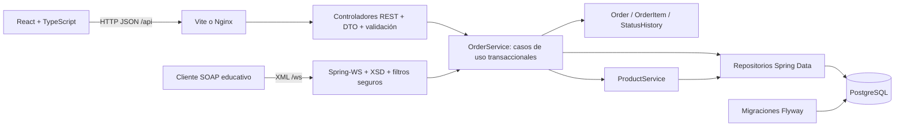

# Arquitectura y decisiones

## Monolito modular

`orders` depende de la consulta del catálogo de `products`; products no conoce pedidos. Los controladores traducen HTTP y delegan. Los DTO de aplicación son el contrato que también reutiliza SOAP, sin serializar entidades. Los repositorios son interfaces porque Spring Data implementa persistencia; los servicios concretos no reciben interfaces artificiales.

Las entidades contienen las invariantes del estado y dinero. Las anotaciones JPA en el dominio son una decisión pragmática para este monolito: evita duplicar modelos y mapeadores, a cambio de acoplar la persistencia a JPA. No es una arquitectura hexagonal estricta. Constructor injection hace explícitas las dependencias. La consulta de productos es una capacidad separada reutilizable. No hay ciclos, sesiones ni estado de negocio en memoria del backend.

## Consistencia y rendimiento

- Transacción única al crear; rollback completo si algo falla. Las actualizaciones usan `@Version` y la versión del cliente. Una restricción adicional impide historiales duplicados por estado.
- Número `PED-` + UUID v4 completo (128 bits con los bits de versión correspondientes), sin contadores en memoria; restricción UNIQUE como garantía final.
- FK, checks monetarios/cantidades, índices en creación, estado/fecha, total y historial.
- Listados paginan exclusivamente la raíz Order y proyectan DTO sin recorrer colecciones. No hay fetch joins de colecciones con paginación. El detalle carga ítems e historial explícitamente dentro de la transacción de lectura; acceder al identificador del producto no inicializa sus proxies. OSIV está desactivado.
- Búsqueda `LIKE` literal escapando `%`, `_` y el carácter de escape. Para un volumen grande podría añadirse un índice trigram, después de medir; no se introduce esa extensión ahora.
- Estadísticas por estado en transacción REPEATABLE_READ para mantener un snapshot consistente. No dependen de la página que ve la web.
- Tiempo en `Instant` y PostgreSQL `timestamptz`; presentación local del navegador. Dinero numeric/BigDecimal, escala 2 y HALF_UP al fijar precio y subtotal.
- Flyway crea y versiona esquema; Hibernate solo valida. Datos locales separados de migraciones de producción: seed repetible con ON CONFLICT DO NOTHING, sin adelantar la versión del esquema ni sobrescribir pedidos. Volumen PostgreSQL persistente.

## REST, SOAP y SOLID

REST es un estilo para trabajar con recursos mediante HTTP, verbos y códigos: es la API exigida por el taller y la utilizada por React. SOAP es un protocolo de mensajes XML con sobre, Faults y contrato XSD/WSDL: la operación GetOrderStatus es una ampliación educativa. SOLID no es un protocolo ni reemplaza REST/SOAP: son principios para distribuir responsabilidades y controlar dependencias.

Responsabilidad única: controladores, casos de uso, dominio y persistencia tienen tareas delimitadas. Abierto/cerrado: otro adaptador como SOAP reutiliza el caso de uso sin cambiar las reglas. Sustitución e interfaces segregadas: se aprovechan los contratos de Spring Data; no se inventan jerarquías. Inversión de dependencias: servicios reciben dependencias por constructor; no crean conexiones ni buscan componentes globales.

SOAP usa DOM para una operación pequeña, evitando código generado JAXB innecesario. XSD valida el payload y genera WSDL. Un filtro StAX endurecido valida el XML antes de SAAJ: sin DTD ni entidades externas, límite 64 KiB. UUID inválido y pedido ausente producen Fault de cliente; otros errores no exponen detalles internos.

## Versiones y fuentes oficiales consultadas

| Tecnología | Versión fijada / compatibilidad |
|---|---|
| Java | release 21; contenedores Temurin 21 |
| Spring Boot | 3.5.16; compatible con Java 21 |
| springdoc | 2.8.17; rama compatible con Boot 3.5 |
| Maven | Wrapper 3.9.11 |
| PostgreSQL | 17.6-alpine |
| Testcontainers | 1.21.3, JUnit 5 y Mockito gestionados por Boot |
| React / TypeScript | 19.2.0 / 5.9.3 |
| Vite / Tailwind | 7.3.8 / 4.1.17 con plugin Vite |
| Router / Query | 7.18.5 / 5.90.7 |
| Formularios | RHF 7.66.0, resolver 5.2.2, Zod 4.6.7 |
| Vitest / Playwright | 4.1.12 / 1.56.1 |
| Node en build Docker | 22.21.1-alpine |

Fuentes: [requisitos Spring Boot 3.5](https://docs.spring.io/spring-boot/3.5/system-requirements.html), [matriz springdoc](https://springdoc.org/v2/), [requisitos Vite 7](https://v7.vite.dev/guide/migration), [Tailwind con Vite](https://tailwindcss.com/docs/installation/using-vite). Versiones exactas también verificadas resolviendo dependencias y ejecutando compilación/pruebas. npm es el único gestor frontend y `package-lock.json` está incluido. Se fija una corrección transitiva de minimatch 11.0.1 para typescript-eslint; lint y pruebas validan la integración y npm audit no reportó avisos al cierre.

Las imágenes externas tienen etiquetas de versión, sin `latest`; para un pipeline con reproducibilidad binaria estricta deberán fijarse también por digest y renovarse mediante un proceso de actualizaciones. Los builds de aplicación y sus versiones están fijados, pero las etiquetas del registro y los paquetes del SO pueden recibir actualizaciones.

## Etapas realizadas y futuras

1. Modelo, persistencia, REST y errores.
2. SOAP, interfaz responsive y formularios.
3. Pruebas unitarias, PostgreSQL, navegador y contenedores.
4. Documentación y evidencias locales.
5. Despliegue manual en EC2 con Docker Compose, comprobado el 15 de noviembre de 2026.
6. Pendiente: repositorio remoto, CI/CD, HTTPS y autenticación.

